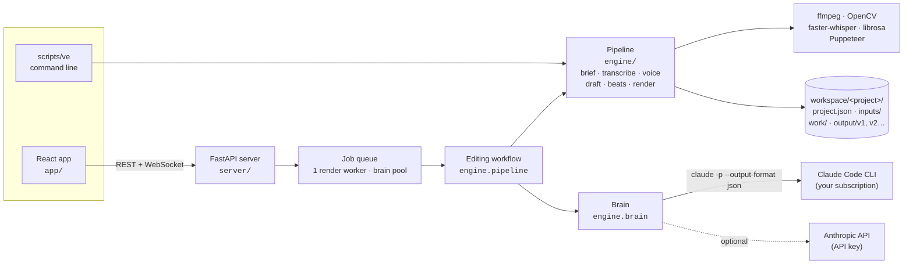

# Cutroom

**An AI video editor that turns raw clips, a voice memo and a song into a finished 9:16 Reel, with Claude making the
editing decisions and a deterministic FFmpeg/OpenCV/Whisper pipeline doing everything else.**

<!-- Demo: replace with a GIF of a full edit (brief -> plan -> trim -> render) -->


I built it for my own short-form content (lifestyle, fashion, gym). An editor's real job is a series of judgement
calls: which take to keep, which shot shows which line, where the cut lands, what the label says. Cutroom gives those
calls to an LLM as **structured, validated output**, and keeps them out of everything that has to be exact: timing,
framing, audio and rendering. Every call comes with a reason you can read, and every one can be changed by hand in
the review screen before anything renders.

→ **[Case study](docs/CASE_STUDY.md)**: the hard problems and how they were solved, including two debugging stories.

→ **[Guide](docs/GUIDE.md)**: every screen, the API, the command line and the development workflow.

---

## How it works



A **plan** job runs the steps a human editor would, splitting them between software and the brain:

| Step | Who | What |
|---|---|---|
| Check the brief | software + brain | gaps (no music for a beat-cut preset, missing files…) become one round of questions |
| Transcribe | software | faster-whisper word timestamps, in a subprocess (it never shares a process with OpenCV) |
| Clean the voiceover | software | noise reduction, de-ess, compression, −16 LUFS; timing untouched |
| Match B-roll | brain | which clip shows which spoken phrase; it reads contact sheets when file names say nothing |
| Draft | software | silences and fillers cut, best moments of silent clips scored, cuts snapped to the beat |
| Plan | brain | reviews the draft like an editor: best takes, structure from the preset, labels, a reason for every call |
| Review | you | reorder, swap, trim on a filmstrip, edit text; each save re-runs the pre-render check |
| Render | software | face-aware 9:16 framing, speed ramps, transitions, captions/text layer, grade, loudness-normalised mix |

The brain is **Claude Code run headless** (`claude -p --output-format json`) on the user's own subscription: no API
key, no settings, hooks, MCP servers or session history, and `Read` as the only tool, limited to the project's
`work/` folder. Every brain function returns JSON that is validated against a Pydantic schema and then checked
against the real project (do these files exist, is this phrase actually said). On failure the call is retried once
with the problems listed. An Anthropic API backend sits behind the same interface.

## Technical challenges

- **Making an LLM's edit plan safe to render.** A plan can't just be well-formed JSON; it has to be renderable. Every
  answer passes the schema, a file check and a full timeline layout before it's accepted, and the same validator runs
  on every manual edit and before every render. One real bug got past all of that: an empty file path resolves to
  the project folder, which exists. [How it was found and closed.](docs/CASE_STUDY.md#bug-2-a-sound-effect-that-passed-every-check)
- **Cuts that land on the beat, not near it.** Beat trackers lock onto hi-hats and lag the kick's attack by a frame or
  two. The grid is phase-checked against low-band kick energy, shifted onto the attack transient, and filled through
  quiet passages; then the layout snaps cut points to it at frame accuracy, never cutting a spoken word.
- **Telling a shaky camera from a moving subject.** Rejecting frames on plain frame difference throws away every shot of
  someone dancing. Camera motion is estimated with tracked corners + RANSAC (phase correlation as a fallback), and only
  its high-frequency part counts as shake, so smooth pans pass.
- **Showing what's being said.** In voiceover edits each B-roll shot should appear as its phrase is spoken. Shots are
  cued to phrases that are verified against the transcript (fuzzy enough for "mealprep" and "chess day"), placed
  80 ms before the word, and spaced so that no shot lands on top of another.
- **Learning from hand edits without fooling itself.** When the creator approves a plan, their changes become
  preferences for that content type. The counting rules stop a preference from confirming itself: only a genuine
  hand edit counts, re-approving changes nothing, and editing the other way counts against it.

## Tech stack

- **App:** React 19, TypeScript, Vite, Tailwind CSS 4 + shadcn/ui (Radix), TanStack Query, dnd-kit; a typed API client
  generated from the server's OpenAPI schema
- **Server:** FastAPI, Pydantic v2, a background job queue with WebSocket progress; job records persist across restarts
- **Brain:** Claude Code CLI (headless, structured output); optional Anthropic API backend
- **Media pipeline:** FFmpeg, faster-whisper (word timestamps), librosa (beats, drops), OpenCV (sharpness, motion,
  YuNet face detection), Puppeteer (captions and text rendered as transparent PNG layers), osxphotos (Mac Photos import)
- **Testing:** pytest (142 tests, brain mocked, real FFmpeg renders of generated media), Vitest + Testing Library
  (41), Puppeteer walkthroughs of every screen in a real browser that fail on any console error, a custom ESLint rule

## Setup (macOS)

1. **Homebrew, Python 3.10+, Node, ffmpeg**
   ```bash
   brew install python@3.12 node ffmpeg
   ```
2. **Claude Code**, logged in once (it's the editing brain):
   ```bash
   npm install -g @anthropic-ai/claude-code
   claude
   ```
3. **Cutroom**
   ```bash
   git clone https://github.com/JT-TEGA/cutroom.git && cd cutroom
   scripts/setup.sh      # venv + Python deps, npm (Puppeteer), fonts, face model, SFX kit; ends with a health check
   ```
   The Whisper model (~1.6 GB) downloads on the first transcription.
4. **Run**
   ```bash
   ./cutroom             # API on :8000 + app on :5173, opens the browser
   ./cutroom --demo      # scripted brain + separate demo workspace: try everything without using Claude
   ```

Tests: `.venv/bin/python -m pytest` and `cd app && npm test`. The end-to-end browser checks, the API and the command
line are covered in the [guide](docs/GUIDE.md).
