# Cutroom guide

The screens, features, API and development workflow in detail. For what Cutroom is and how it's built, see the [README](../README.md) and the [case study](CASE_STUDY.md).

## The app

| | |
|---|---|
|  |  |
| **Projects**: every video with its status (draft, planning, needs review, rendering, done), live progress, search and a filter by content type | **New video, step 1**: the content type, grouped Lifestyle / Fashion / Gym |
| 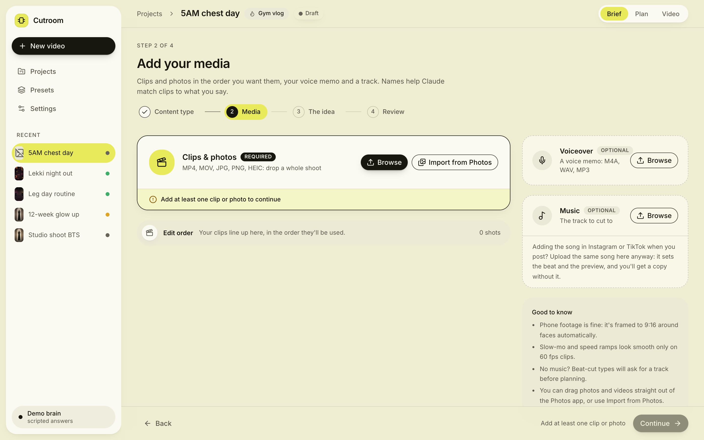 |  |
| **Step 2, before the first clip**: clips & photos is the one required card (Browse, or Import from Photos), voiceover and music are optional; the edit order waits as a slim bar and Continue stays off until there is a clip or photo | **Step 2, media**: drop clips and photos, a voice memo (or record one) and a track; drag to reorder, click a name to rename it |
| 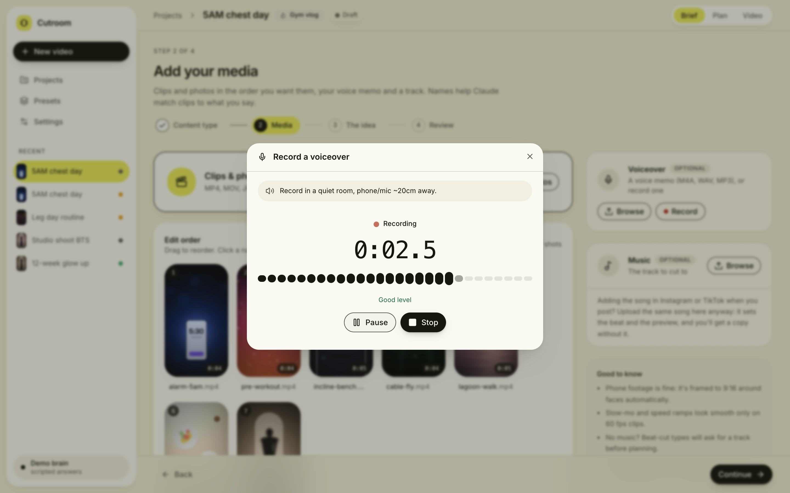 | 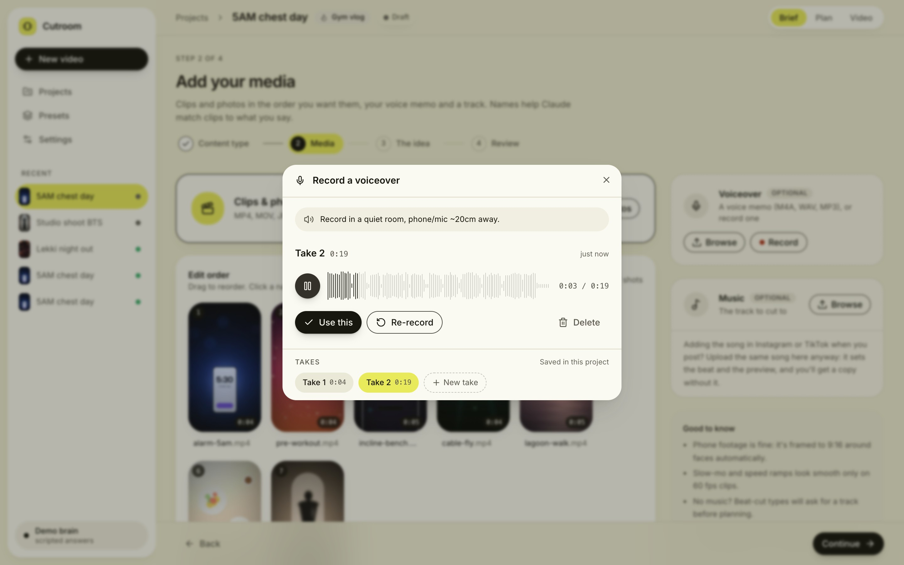 |
| **Record a voiceover** from the Voiceover card: a live mic level with a hint (quiet / good / too loud), a running timer, Pause and Stop | **Takes**: listen back on the waveform, Re-record, Delete; **Use this** puts the picked take in the Voiceover slot, where it's cleaned up and transcribed like any voice memo |
|  | 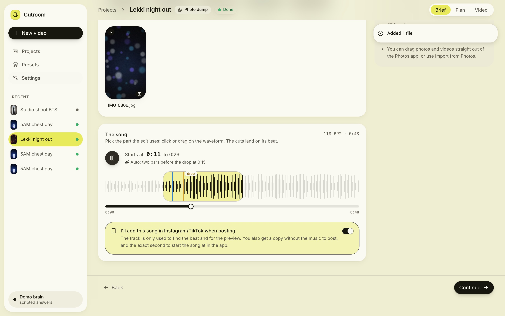 |
| **Step 3, the idea**: the brief as a form that autosaves; the preset's defaults are the placeholders, advanced fields fold away | **The song**: the waveform with the part the edit uses lit up (auto: just before the drop, or the strongest stretch), drag or slide to pick your own start, play from there; "I'll add this song in Instagram/TikTok when posting" |
| 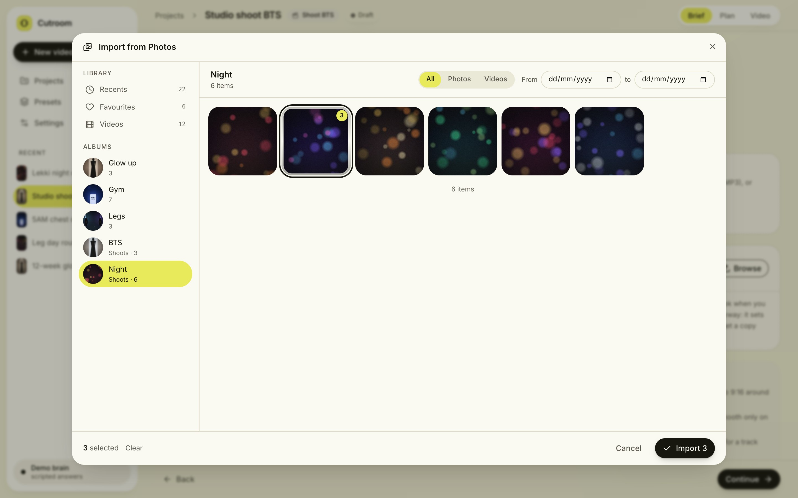 | 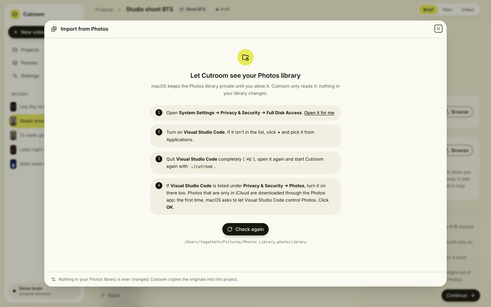 |
| **Import from Photos**: albums, recents, favourites and videos from the Mac Photos app, multi-select across albums, a date filter, Live Photos as still or video, iCloud-only items downloaded on import | **No access yet?** The exact System Settings steps for the app Cutroom runs from, and Check again |
| 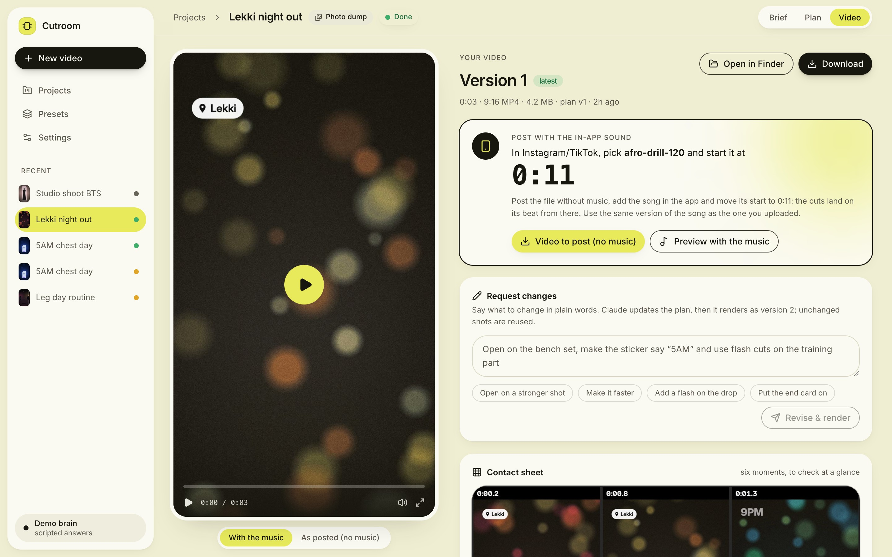 |  |
| **Post with the in-app sound**: the song and the second to start it at, the file to post (no music) and the preview with music; a reminder to turn the song down when you talk | **Step 4, review**: checks and what happens next |
|  |  |
| **Claude reads the brief** (live over the job WebSocket) | **Questions**: anything Claude needs, asked once, with suggested answers and the assumptions it will make |
|  |  |
| **Planning**: each stage of the pipeline, the progress bar and the log | **Claude is planning…** while the brain call runs |
|  |  |
| **Timeline review**: click a shot for the reason it's there, the words heard over it, its transition; swap or delete it | **Labels**: edit the text and style; drag shots to reorder, drop a clip from Media onto a shot to swap it, ⌘Z to undo |
| 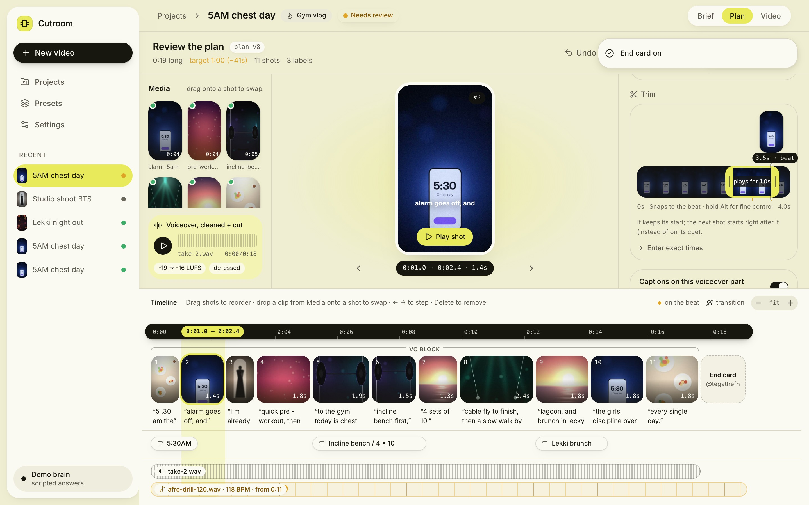 | 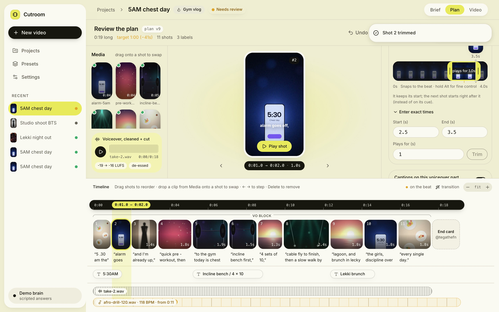 |
| **Visual trimmer**: the whole clip as a filmstrip; drag the handles (the trimmed-off part dims), with the time on the handle and how long it plays live. The end snaps to the clip's ends and, in beat-cut edits, to the beat; hold Alt for fine control. The frame under the playhead shows above it; click or drag the strip to move it | **Enter exact times**: Start / End / Plays for, folded away by default, moving with the handles both ways. Never shorter than 0.3 s |
| 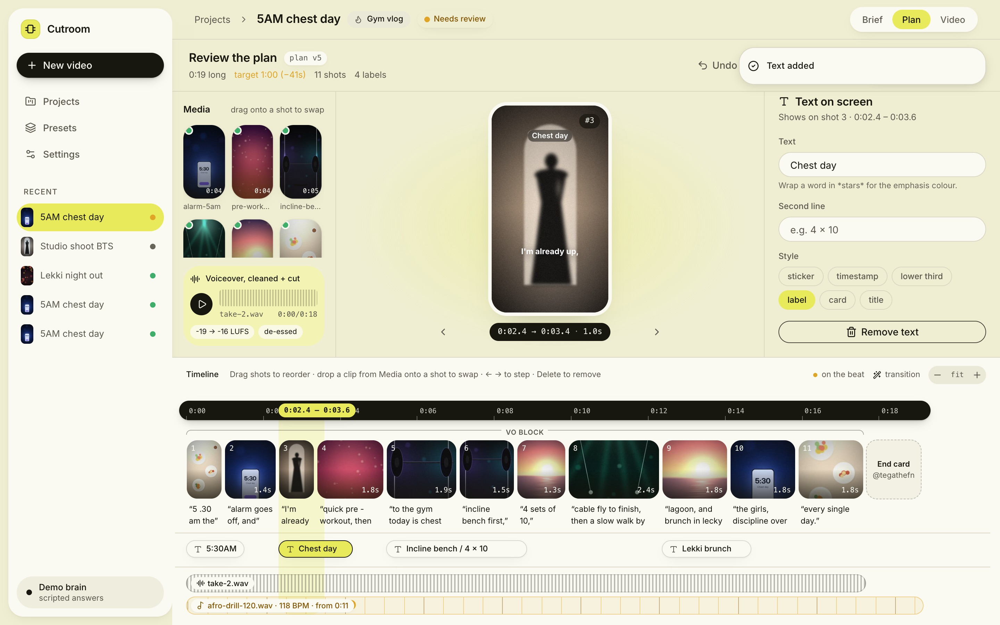 | 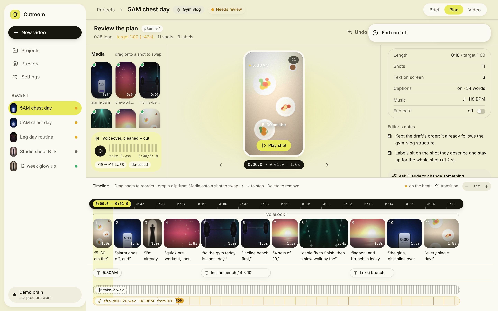 |
| **Your own edits**: trim on the filmstrip or set how long a shot plays, captions on or off per part, add text on a shot (kept up long enough to read). Each save runs the pre-render check; an edit that would make the plan worse is undone with the reason | **End card** on or off for the video, from the plan overview. When you approve, what you changed becomes notes Claude follows on your next videos of that type (seen in 2+ videos) |
|  |  |
| **Rendering**: live progress per stage | **Result**: the 9:16 player, Download, Open in Finder, request changes, the contact sheet |
|  |  |
| **Version 2** after “make the first label say 5AM and use flash cuts”: versions side by side | **Settings**: handle, colours, captions with a live preview in the real font, music levels, end card |
|  |  |
| **Brain**: Claude Code or the Anthropic API, with connection status and the system check | **Presets**: each content type's notes and defaults, editable |
|  |  |
| **When Claude can't work** (usage limit, logged out, not installed, no API key) a banner says what to do | **Revising**: your notes go to Claude, then straight to a new render |
|  | 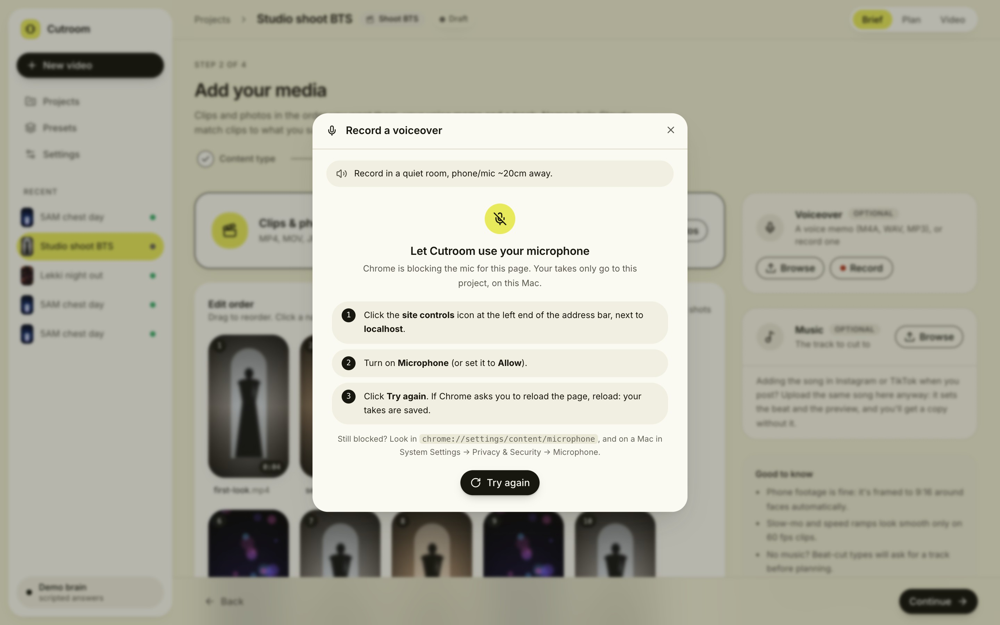 |
| **If a screen ever crashes**: a calm error screen inside the app with Go back / Reload and the technical details folded away | **Mic blocked?** How to allow it in Chrome (or in macOS, when it's the Mac saying no), then Try again |

The screenshots come from a real end-to-end run against `./cutroom --demo`: synthetic footage, a `say` voice memo
(recorded in the app's recorder, through Chrome's fake microphone) and a generated beat track went through the wizard, the pipeline (transcription, voice clean-up, beat detection,
rendering) and the scripted brain. See [Development](#development) to regenerate them.

### Posting with the in-app sound

Reels and TikToks get more reach with the platform's own copy of a song, so you can add the song in the app instead of
baking it in. Turn on **"I'll add this song in Instagram/TikTok when posting"** in the Music step (or the brief).
Upload the same song anyway: Cutroom cuts to its beat and uses it for the preview, and every render then gives you two
files: `<name>_vN.mp4` with the music (to check) and `<name>_vN_post.mp4` with your clips' own sound, your voice and
any sound effects but no music (to post). The Result screen says which song to pick and where to start it, e.g.
**0:42**: the start is always a whole second because that's what the apps let you pick, and the song plays from the
first frame. If you talk in the video, it reminds you to turn the song down in the app (about 20%).

Which part of the song the edit uses is yours to choose in the Music step: click or drag on the waveform, or use the
slider, and play from there. Left on **Auto** it starts two bars before the drop that leads into the loudest part (or,
without a drop, the loudest stretch as long as the video).

### Recording a voiceover

No voice memo yet? **Record** on the Voiceover card records one in the browser (the first time, Chrome asks for the
mic). Record in a quiet room with the phone or mic about 20 cm away; the meter says when you're too quiet or too loud.
Every take is kept in the project (`inputs/voiceover/takes/`), so they're still there after a refresh: listen back,
re-record as often as you like, delete the ones you don't want. **Use this** uploads the take you pick through the
same files endpoint as an imported memo, where it's converted to 48 kHz mono WAV, so the clean-up, transcription,
voiceover mode and `vo_preview.wav` treat it exactly like one (using another take later swaps it in). The browser's
call-style processing (echo cancellation, noise suppression, auto gain) is turned off: Cutroom's own clean-up does
that job better.

### Import from Photos

**Import from Photos** in the Media step opens your Mac's Photos library (read with
[osxphotos](https://github.com/RhetTbull/osxphotos), installed by `scripts/setup.sh`): albums with counts and covers,
recents, favourites, videos, a date filter and multi-select. Importing copies the **originals** into the project
(HEIC is converted when it's used, as with any upload; Live Photos come in as the still unless you pick the video
part; RAW becomes JPEG). Items that are only in iCloud are downloaded through the Photos app first. Nothing in your
library is ever changed. Dragging photos and videos straight out of the Photos app onto the drop zone works too.

macOS keeps the Photos library private, so the app you start Cutroom from needs access once:

1. **System Settings → Privacy & Security → Full Disk Access**: turn on the app you run `./cutroom` from
   (Terminal, iTerm or Visual Studio Code; add it with **+** if it isn't listed).
2. Quit that app completely (⌘Q), open it again and run `./cutroom` again.
3. For photos that are only in iCloud: the first import asks to let that app control Photos. Click **OK** (it's under
   Privacy & Security → Automation if you need it later).

Until then the picker shows these steps (naming the right app) and a **Check again** button; it never errors out.

## From the terminal

A whole edit from the terminal (`?wait=true` blocks until a job is done; without it you get a job to poll or
stream from `ws://127.0.0.1:8000/ws/jobs/<id>`):

```bash
API=http://127.0.0.1:8000
ID=$(curl -s -X POST $API/projects -H 'content-type: application/json' \
  -d '{"name": "Lekki night", "brief": {"content_type": "photo-dump", "talking": "no",
       "idea": "night out with friends", "labels": "Lekki, 7PM"}}' | jq -r .id)

curl -s -F files=@clip1.mov -F files=@clip2.mov -F files=@IMG_0042.HEIC $API/projects/$ID/files
curl -s -F kind=music -F files=@track.mp3 $API/projects/$ID/files

curl -s -X POST "$API/projects/$ID/analyse?wait=true" | jq .result.questions    # anything to answer?
curl -s -X POST "$API/projects/$ID/plan?wait=true"    | jq .result.shots        # the timeline
curl -s -X POST "$API/projects/$ID/render?wait=true"  | jq .result              # output/v1/
curl -s -X POST "$API/projects/$ID/revise?wait=true" -H 'content-type: application/json' \
  -d '{"notes": "open on the dancing clip, sticker should say 8PM", "render": true}'
```

`GET /system/status` checks ffmpeg, Node/Puppeteer, Python packages, the Whisper model, fonts and Claude Code
(installed + logged in).

### API overview

| | |
|---|---|
| `GET/POST /projects`, `GET/PATCH/DELETE /projects/{id}`, `POST /projects/import` | projects; import a `briefs/*.md` |
| `POST/GET/PATCH /projects/{id}/files`, `PATCH/DELETE /projects/{id}/files/{file}` | uploads (HEIC ok), order, rename, trims |
| `POST /projects/{id}/analyse` · `plan` · `render` · `revise` · `reference` | background jobs |
| `GET/PUT /projects/{id}/timeline` | the plan, resolved to output times (each shot knows its segment); save your own edits |
| `GET /projects/{id}/voiceover`, `POST /projects/{id}/reveal` | voice preview + clean-up numbers; show a render in Finder |
| `GET/POST /projects/{id}/takes`, `DELETE /projects/{id}/takes/{take}` | voiceover takes recorded in the app, kept until one is uploaded as the voiceover (`POST .../files` with `kind=voiceover`, `take=<id>`) |
| `GET /projects/{id}/music` | the song: waveform, BPM, drops, the auto start and your pick (`PATCH` the brief's `music_start` / `music_in_app`) |
| `GET /photos/status` · `POST /photos/refresh` · `GET /photos/albums` · `GET /photos/items` · `GET /photos/thumbnail/{id}` | the Mac Photos library (status says what to do without access) |
| `POST /projects/{id}/photos/import` | a job: copy originals from Photos into the project, with what was skipped and why |
| `GET /jobs/{id}`, `WS /ws/jobs/{id}` | status, step, % done, log lines, result |
| `POST /jobs/{id}/retry` | run a failed, cancelled or interrupted job again with the same inputs |

Job records are saved in each project's `work/jobs.json`, so they survive a server restart. A job that was queued
or running when the server stopped comes back as `interrupted`, ready to retry.
| `GET /projects/{id}/outputs`, `…/outputs/{v}/video`, `…/outputs/{v}/post` | versions; video streams with HTTP Range (`?download=true` to save); `post` is the copy without music |
| `GET /media/thumbnail?path=&t=`, `GET /media/file?path=` | thumbnails (at a time); any workspace file, range-enabled |
| `GET /presets`, `PUT /presets/{name}`, `GET/PUT /settings`, `GET /system/status`, `GET /fonts/{file}` | configuration |

## The command line still works

The original chat-driven workflow (Claude Code reading `CLAUDE.md`) runs on the same engine:

```bash
scripts/ve brief briefs/my-video.md      # parse + gaps
scripts/ve draft my-video raw/a.mp4 raw/shoot/
scripts/ve render my-video
scripts/ve import briefs/my-video.md     # turn a brief into an app project
scripts/ve doctor                        # health check
```

See [scripts/README.md](../scripts/README.md) for every command and the edit-plan format.

## Project layout

```
engine/            the pipeline as a package
  brain/           Brain interface, Claude Code + API backends, task prompts (prompts/*.md)
  pipeline.py      the editing workflow for app projects
  project.py       projects in workspace/<id>/
  timeline.py      the edit plan as Pydantic models + resolved view
  photos.py        the Mac Photos library (osxphotos): albums, items, thumbnails, importing originals
  config.py        configurable paths, per-job layout, progress reporting
  render.py …      framing, overlay, audio mix, export (carried over from the chat era)
server/            FastAPI app, routes, background job queue
app/               React app: Vite, TypeScript, Tailwind + shadcn/ui, TanStack Query (see app/README.md)
cutroom            one command: API + app + browser (--demo for the scripted brain)
presets/           content-type presets (photo-dump, gym-vlog, …): notes + settings
brand.md           the creator's look; its settings block is what GET/PUT /settings edits
assets/            fonts, SFX
scripts/           ve (the CLI), setup.sh, demo_media.py (synthetic footage for demos)
tests/             pytest: brief parsing, timeline schema, brain (mocked), API, end-to-end render
docs/screenshots/  the app, from the walkthrough below
workspace/         projects (git-ignored)
```

Paths to shared resources can be moved with `CUTROOM_ROOT`, `CUTROOM_WORKSPACE`, `CUTROOM_PRESETS`,
`CUTROOM_BRAND`, `CUTROOM_FONTS`, `CUTROOM_SFX`, `CUTROOM_MODELS` and `CUTROOM_CLAUDE_BIN`.

## Development

```bash
.venv/bin/python -m pytest        # 142 tests, about a minute; never calls Claude (the brain is mocked) or reads your Photos library
.venv/bin/ruff check .
cd app && npm run lint            # the app's lint (also runs in npm run build); npm run gen:api regenerates its typed client
cd app && npm test                # 41 tests (Vitest + jsdom): the voiceover recorder with a mocked mic, the plan
                                  # screen's edits, the visual trimmer
```

`npm run lint` includes `cutroom/effect-returns` (app/eslint-rules/), which fails on any `useEffect` that can return
something other than a cleanup function: async effects, one-line effects like `useEffect(() => el.scrollTo(...))`,
`return setTimeout(...)`. React calls whatever an effect returns when the screen unmounts, so those crash with
"destroy is not a function" (newer Chrome made `scrollTo()` return a Promise, which is how one slipped in).

The end-to-end test generates tiny clips, a photo and a 120 BPM track, then plans, edits, renders, revises and
renders again through the API. `tests/test_takes.py` uploads recordings the way each browser's MediaRecorder makes
them (Chrome's WebM Opus without a duration, Firefox's Ogg, Safari's MP4) and checks they become 48 kHz WAV
voiceovers that the analysis and clean-up treat like any voice memo.

The app is checked end to end in a real browser (headless Chrome via Puppeteer) against the demo brain:

```bash
.venv/bin/python scripts/demo_media.py             # synthetic clips, photos, a voice memo, a track -> .demo/media
./cutroom --demo --no-open &
node app/scripts/walkthrough.mjs                   # every screen, start to finish -> docs/screenshots/*.jpg
                                                   # (the voiceover is recorded: Chrome's fake mic plays the demo memo)
node app/scripts/check-interactions.mjs            # drag to reorder, swap from the bin, delete + undo, edit a label,
                                                   # drops the way the Photos app hands files over
```

In demo mode, Import from Photos reads a stand-in library made from `.demo/media` (its folders are the albums, two
items act as iCloud-only), so no run ever touches your own library. `CUTROOM_PHOTOS=denied ./cutroom --demo` shows
the no-access screen (`node app/scripts/walkthrough.mjs --photos-denied` takes its screenshot).

Both leave every screen and come back (client-side, so screens really unmount), including mid-planning and
mid-render; the walkthrough then sweeps every route and the error screen (`--sweep-only` runs just that). Any page
error or console error fails the run. They use Puppeteer's Chrome; to test your own browser, point
`CUTROOM_CHROME` at it, e.g. `CUTROOM_CHROME="/Applications/Google Chrome.app/Contents/MacOS/Google Chrome"`.

`CUTROOM_DEMO_FAIL=usage_limit ./cutroom --demo` makes the demo brain fail like Claude Code at its usage limit
(`node app/scripts/walkthrough.mjs --usage-limit` takes that screenshot).
